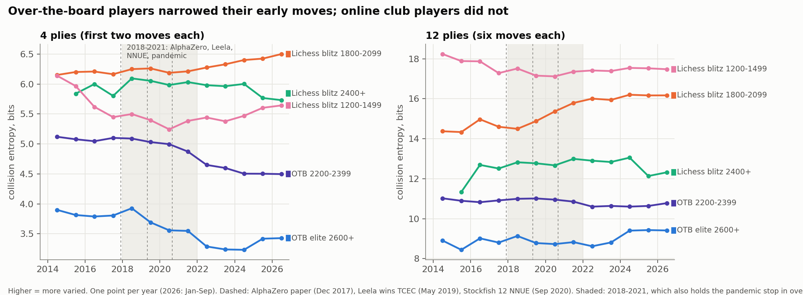
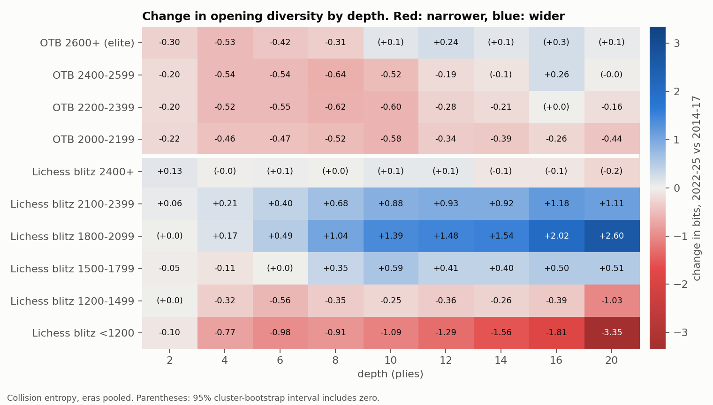
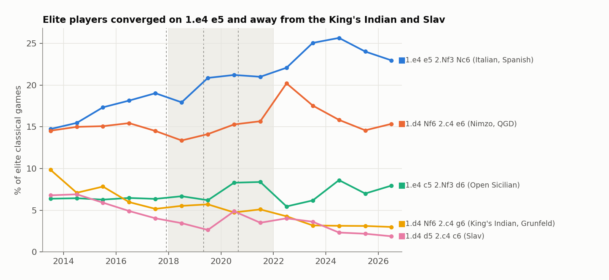
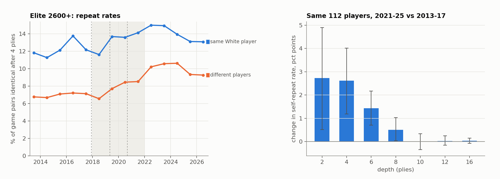
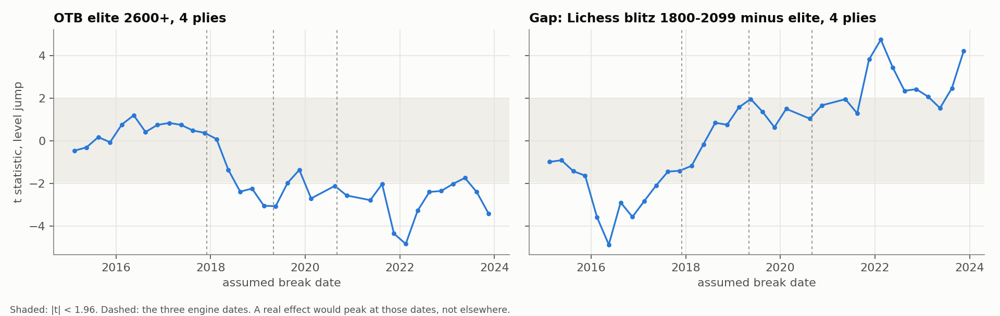

# Engine monoculture

Did superhuman chess engines make top players' openings more alike, while amateurs
spread out? This project measures how varied chess openings are, ply by ply, in
2.5 million over-the-board games from The Week in Chess (2012-2026) and 39.5 million
Lichess games sampled from every monthly dump (2013-2026), then tests for breaks at
the engine milestones: the AlphaZero paper (December 2017), Leela winning TCEC
(May 2019) and Stockfish 12 with NNUE (September 2020).

**Headline: the top did narrow, but not alone and not for good.** Over the first two
moves, games between two 2600+ players went from **14.3 to 9.9 effective lines**
(collision entropy 3.83 to 3.30 bits, change -0.53 [-0.63, -0.43]) between 2014-17
and 2022-25. But every over-the-board rating band from 2000 to 2599 lost the same
half a bit, so this is a change in over-the-board chess, not an elite one. Further
into the game the elite went the other way: by the sixth move each, their lines were
slightly *more* varied than before (+0.24 bits [+0.03, +0.46]). Online, the 1500-2399
Lichess blitz bands spread out, most of all deep in the opening (+1.48 bits at ply 12
for 1800-2099), while beginners and bullet players narrowed and titled-strength
players (2400+) did not move. The amateur-minus-elite gap did widen for the middle
bands (+0.70 bits at ply 4 for 1800-2099), but as a single step that the data date to
early 2022, when over-the-board chess resumed after the pandemic, not as a gap that
keeps growing. Since 2024 elite diversity at ply 4 has partly recovered (3.23 to 3.42 bits).



## Verdict on the hypothesis

| Claim | Result |
|---|---|
| Top players narrowed onto fewer openings | **Yes at the start of the game** (plies 2-8, -0.3 to -0.5 bits). **No deeper**: flat or wider from ply 10 on. |
| ...because of engines | **Not identifiable.** The same drop hits 2000-2199 club players over the board, and the sharpest break is 2022Q1 (return from the pandemic), not an engine date. |
| Amateurs spread out | **For 1500-2399 online blitz, yes**, strongly at depth. Below 1500, bullet, and 2400+: no. |
| The gap keeps growing | **No.** One step around 2019-2022 for the middle bands, then flat or closing. For beginners the gap shrank. |

## Running it

```bash
pip install -r requirements.txt
```

```bash
python run.py
```

`run.py` runs the steps below in order; each can also be run alone (`python run.py
entropy figures`). The two fetch steps resume where they stopped. Fetching takes about
two hours on a home connection (TWIC is 950 MB of zips, cached; the Lichess sampler
reads about 125 MB per month out of dumps that reach 30 GB and keeps only a parquet).
`python -m pytest tests` runs 8 unit tests.

| file | role |
|---|---|
| `fetch_twic.py` | downloads TWIC issues 920-1665, parses PGN, classifies each game as over-the-board classical, fast (rapid, blitz, knockout tiebreaks) or online |
| `fetch_lichess.py` | samples each Lichess dump with HTTP range requests at 24 random offsets spread over the month, decoding from the next zstd frame |
| `canonicalize.py` | rewrites the over-disambiguated SAN in the 2013-14 dumps (see Traps) |
| `validate.py` | replays a sample of both sources with python-chess to confirm both spell moves the same way |
| `entropy.py` | diversity per group, period and depth (1-20 plies) |
| `breaks.py` | segmented regressions at the engine dates, a placebo scan of every quarter, and an unknown-break sup-F test |
| `players.py` | splits elite repeat rates into same-player and different-player pairs; fixed panel of 112 players |
| `robustness.py` | era comparison with cluster bootstrap; fixed set of recurring events |
| `figures.py`, `report.py` | figures and every number in this README (`out/summary.md`) |

## Method

**Groups.** Over the board (TWIC): classical games only, banded by the *lower* of the
two FIDE ratings: 2600+ (elite), 2400-2599, 2200-2399, 2000-2199. Online events
(1.1 million games), rapid and blitz events and World Cup
tiebreaks (game 3 and up of a knockout round) are excluded. Lichess: bullet, blitz
and rapid, banded by the mean rating of the two players. Every game must reach 20
plies, so each group is measured on the same sequences.

**Diversity.** For each group, period and depth d, count how often each d-ply move
sequence occurs. The main measure is **collision entropy**, -log2 of the chance that
two different games from the group share their first d plies, with 2^H read as the
effective number of equally common lines. Its pair-count estimator is unbiased at any
sample size and does not saturate at deep plies, where almost every game is unique;
that matters because the elite have 2,500 games a year and Lichess bands 60,000. As
the brief asks, Shannon entropy is computed too: plug-in on random subsamples of
exactly 200 games per cell (so every group is measured at the same N) and Chao-Shen on
the full cell. At plies 4 and 6, where N = 200 does not saturate, Shannon moves the same
way as collision entropy for every group checked (`out/summary.md`, Shannon check).

**Tests.** (1) Segmented regression on the quarterly series at each engine date, with
a jump and a change of trend, Newey-West standard errors. (2) The same fit at every
quarter from 2015 to 2024 as a placebo: a real effect should make the jump statistic
peak at an engine date. (3) Sup-F for one unknown break, p value by AR(1) residual
bootstrap. (4) Era comparison 2014-17 vs 2022-25, leaving out 2018-21, which holds all
three engine dates and the pandemic, with 95% intervals from resampling whole events
(TWIC) or months (Lichess). (5) The same comparison restricted to 550 tournaments that
recur in both eras, to hold TWIC's coverage fixed.

## Results

### 1. The early moves narrowed for everyone over the board



| ply 4, collision entropy | 2014-17 | 2022-25 | change [95% CI] |
|---|---|---|---|
| OTB 2600+ | 3.83 | 3.30 | -0.53 [-0.63, -0.43] |
| OTB 2400-2599 | 4.64 | 4.10 | -0.54 [-0.58, -0.50] |
| OTB 2200-2399 | 5.09 | 4.56 | -0.52 [-0.56, -0.49] |
| OTB 2000-2199 | 5.31 | 4.85 | -0.46 [-0.50, -0.42] |
| Lichess blitz 2400+ | 5.95 | 5.93 | -0.02 [-0.11, +0.09] |
| Lichess blitz 1800-2099 | 6.19 | 6.36 | +0.17 [+0.14, +0.21] |
| Lichess blitz 1200-1499 | 5.79 | 5.47 | -0.32 [-0.41, -0.22] |
| Lichess bullet 1800-2099 | 8.03 | 7.43 | -0.60 [-0.64, -0.56] |

The over-the-board drop survives holding the event mix fixed (elite -0.57
[-0.71, -0.44], 2200-2399 -0.52 [-0.58, -0.47] in recurring tournaments) and the
switch to Shannon entropy (elite -0.48 bits at ply 4). That the 2000-2199 band moves
almost exactly like the elite is the main obstacle to an engine-preparation story
told about the top alone: if engines are the cause, their effect reached club
players over the board just as fully, while it did not reach the same rating range
online.

What changed is concrete. Among elite games 1.e4 e5 2.Nf3 Nc6 went from 17.5% to
24.2%, and 1.e4 e5 2.Nf3 Nf6 (Petroff) from 1.6% to 3.6%, while the King's Indian and
Grunfeld complex (1.d4 Nf6 2.c4 g6) fell from 6.5% to 3.4% and the Slav from 5.4% to
3.1%: solid, engine-approved main lines up; dynamic, theoretically suspect ones down.



### 2. Deeper in, the elite spread out again

At ply 12 elite diversity rose (+0.24 bits [+0.03, +0.46]) and its trend after NNUE
turned upward (+0.17 bits a year, p < 0.001). Elite games now funnel into fewer main
roads and then leave them by move six. This is consistent with preparation built on
deep engine lines, where the aim is a novelty the opponent has not seen. It is also
the weakest result here: with the event mix held fixed it shrinks to +0.12 [-0.16, +0.40].

### 3. Players converged on each other, and repeated themselves

Among games between two 2600+ players, the share of pairs with different White
players that are identical after 4 plies rose from 7.0% to 10.2%; pairs with the
same White player from 12.3% to 14.2%. In a fixed panel of 112 players active in both
2013-17 and 2021-25, each player's own repeat rate at ply 4 rose by 2.6 points
[+1.2, +4.0] (63% of players up), and the panel's between-player match rate from 7.3%
to 9.9%. Narrowing is both personal repertoires shrinking and different players
landing on the same lines, with the second growing faster.



### 4. The timing points at 2022, not at the engines

The elite ply-4 series has significant level drops at the Leela (-0.28, p 0.002) and
NNUE (-0.32, p 0.011) dates, but the placebo scan shows the jump statistic is
negative for any assumed break from mid-2018 to 2024 and peaks at **2022Q1 (t -4.8)**.
The sup-F search agrees (break 2022Q1, p 0.017). Over-the-board chess barely existed
from March 2020 to mid-2021 (759 elite classical games in 2020 against about 3,000 in
a normal year), and the narrowing is clearest when it came back. Two years of online
play, home preparation and cancelled events sit on top of the engine dates, and this
design cannot separate them.



### 5. The gap widened once, for the middle bands only

The amateur-minus-elite gap at ply 4 widened by +0.70 bits [+0.60, +0.80] for Lichess
blitz 1800-2099 and +0.74 for 2100-2399, more at ply 8 (+1.35 for 1800-2099). For
players under 1200 it *narrowed* (-0.24 at ply 4, -1.53 at ply 12): beginners
converged faster than the elite, deep into a few trap-rich lines (the most repeated
20-ply sequences among 2024 sub-1200 blitz games are Fried Liver and Italian gambit
lines). The 1800-2099 gap shows no break near the engine dates in the placebo scan,
and since 2024 elite diversity has drifted back up, so the gap is not growing.

## Caveats

- **TWIC is not a census.** Coverage grew and changed (more opens, more online
  events after 2020). The recurring-event check holds this partly fixed; it does not
  fix who plays in those events.
- **Ratings drift.** FIDE ratings inflated slowly and Lichess ratings deflated, so a
  band is not the same population over 13 years. The 112-player panel is the
  composition-free check for the elite.
- **Lichess's player base changed.** Its growth through 2016-2020 and the pandemic surge
  move the amateur bands; many Lichess series break in 2017, not at an engine date.
- **One time control each.** Over the board is classical; Lichess has no classical
  sample worth the name. Bullet narrows like over-the-board chess while blitz widens,
  so time control is a confound in the elite-versus-amateur comparison itself.
- **Sequences, not positions.** Transpositions count as different lines, which
  overstates diversity equally in all groups.

## Traps

- Lichess dumps from October 2013 to June 2014 write over-disambiguated SAN
  ('Ng8e7' for 'N8e7') in up to 17% of games; left alone it inflates early diversity.
  `canonicalize.py` replays those games; from July 2014 `validate.py` finds no
  non-canonical move in either source.
- The dumps are many independent zstd frames, so a byte-range slice can be decoded
  from the next frame header after a random offset.
- TWIC rejects default user agents with a mod_security 406.
- TWIC's Event names hide online and fast events ('FIDE World Bl Team', 'Lindores Abbey
  Stars'); knockout tiebreaks only show in the Round tag ('2.3' and up).
- Bootstrapping collision entropy by resampling clusters with replacement pairs each
  game with its own copy and biases entropy down; `robustness.py` removes those pairs.

## Data

- The Week in Chess, Mark Crowther, theweekinchess.com, issues 920-1665.
- Lichess open database, database.lichess.org, standard rated games 2013-01 to 2026-09 (CC0).
